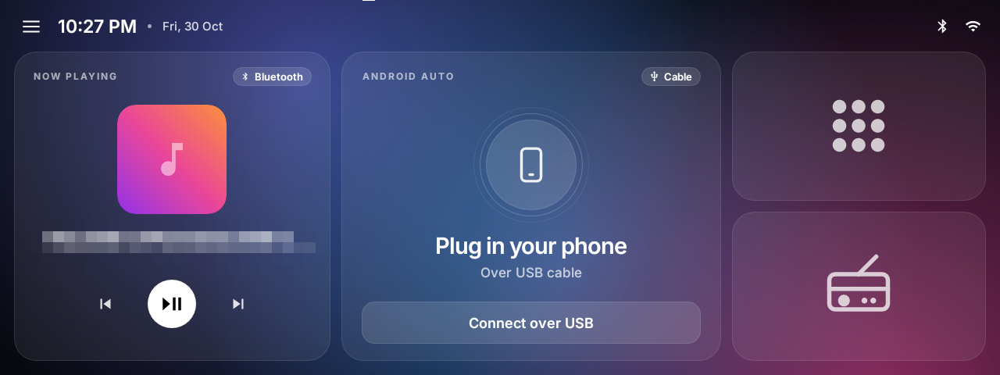
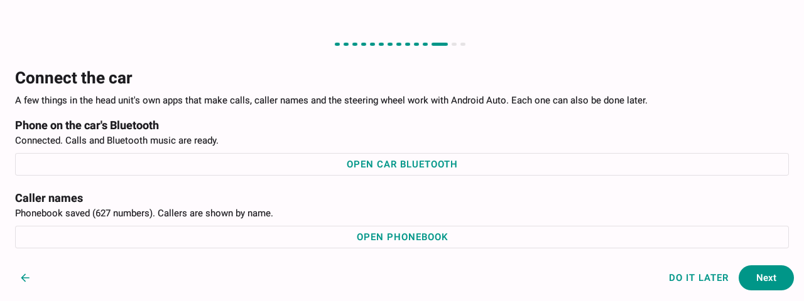
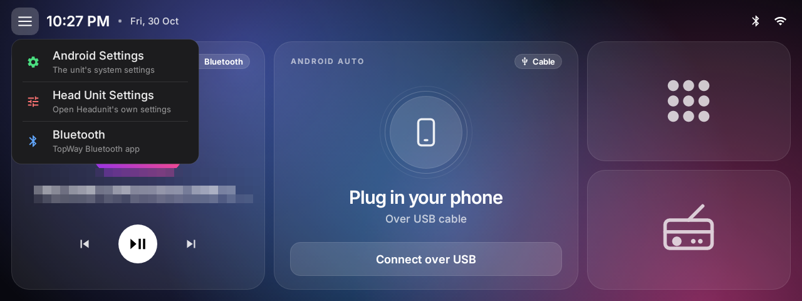
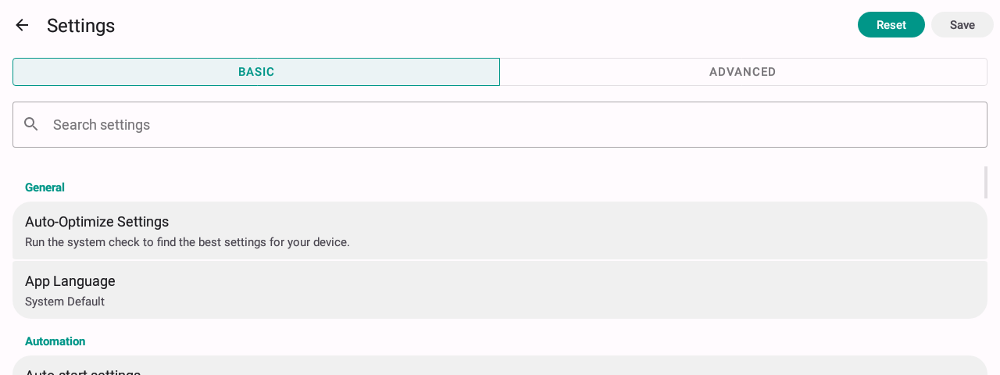

# Open Headunit for Mahindra XUV 3XO (TopWay head unit)

A car-specific build of [Open Headunit](https://github.com/andreknieriem/open-headunit) for the
TopWay Android head unit fitted in a Mahindra XUV 3XO. It turns the head unit into a USB Android
Auto receiver and replaces the stock launcher with a car home screen that works with the unit's
own Bluetooth, FM radio and steering-wheel buttons.

<p align="center">
  
</p>

> **Safety first.** Set everything up while parked. Do not operate the screen while driving.

---

## Contents

1. [What this build adds](#what-this-build-adds)
2. [Supported hardware](#supported-hardware)
3. [What you need](#what-you-need)
4. [Installation](#installation)
5. [First-time setup (step by step)](#first-time-setup-step-by-step)
6. [Connecting your phone to Android Auto](#connecting-your-phone-to-android-auto)
7. [Using the car home screen](#using-the-car-home-screen)
8. [Wireless Android Auto](#wireless-android-auto)
9. [Settings](#settings)
10. [Troubleshooting](#troubleshooting)
11. [Building from source](#building-from-source)
12. [Getting updates from the original project](#getting-updates-from-the-original-project)
13. [Credits and license](#credits-and-license)

---

## What this build adds

**Car home screen**
- Now Playing card for Bluetooth music, Android Auto and FM radio, with play/pause, previous and next.
- Large Android Auto card: shows the connection state and opens Android Auto.
- App Library and Radio tiles.
- Menu (top left) with Android Settings, Head Unit Settings and the car's Bluetooth app.
- Mahindra logo for the app icon and splash screen, and no Android status bar anywhere in the app.

**TopWay integration**
- **Steering-wheel buttons:** learned inside the app and working in Android Auto (volume, track, call answer and hang-up).
- **FM radio:** full tuner screen. It keeps playing when you go back to the home screen and has a single on/off control on the Now Playing card.
- **Bluetooth:** calls and music go through the car's Bluetooth module. Music starts at boot without opening TopWay's Bluetooth app.
- **Caller names:** shown from the phonebook downloaded by the car's Bluetooth.
- **Calls during Android Auto:** Android Auto comes back on screen after the car's call screen closes.

**Android Auto over USB**
- Starts by itself when the phone is plugged in, including a phone that was already plugged in when the car started.
- A solid Home button floats on the Android Auto screen, on the passenger side, and goes back to the car home without stopping Android Auto.
- Unplugging the phone goes straight back to the home screen, with no pop-ups.
- Faster connection start and a much smoother UI on the unit's GPU.

**Cleaned-up settings**
- USB only. All wireless and "self mode" options are removed.
- Debug and advanced options are hidden until you tap **Version** seven times.
- A setup wizard walks new users through the whole car integration.

## Supported hardware

| | Tested unit |
|---|---|
| Car | Mahindra XUV 3XO (right-hand drive) |
| Head unit | TopWay "QUAD-CORE T3 p1" (Allwinner sun8iw11 / T3) |
| Android | 10 |
| Screen | 1280 × 480 |

Other TopWay units running Android 10 will probably work, but only this one has been tested.
Units from other makers (FYT, MTCD and so on) can install it, but the TopWay features (Bluetooth
bridge, radio, steering wheel) will not work on them.

## What you need

- The head unit described above.
- An Android phone with the **Android Auto** app (built in on Android 10 and newer).
- A good USB data cable. Many charge-only cables do not carry data.
- A USB pen drive (FAT32 or exFAT), or a PC with `adb` for the developer route.
- The app's APK file from the [Releases](https://github.com/WCjai/open-headunit-mahindra-3xo/releases) page, or build it yourself ([Building from source](#building-from-source)).

### Which APK to download

| File | Use it when |
|---|---|
| `OpenHeadunit-3XO-<version>.apk` | **Production build.** Use this in the car. Optimised and signed with this project's release key, so later releases install as updates. |
| `OpenHeadunit-3XO-<version>-debug.apk` | **Debug build.** For testing and bug reports. Same features, signed with a debug key. |

Both builds use the same app id but different signatures, so Android will not install one over
the other. To switch, export your settings (**Head Unit Settings → Backup → Export settings**),
uninstall the app, install the other APK and import the settings again.

## Installation

> If **Open Headunit from the Play Store** is already on the unit, uninstall it first. This build
> uses the same app id but a different signature, so Android will refuse to install over it.

### Option A: from a USB pen drive (recommended)

1. Copy the APK (for example `OpenHeadunit-3XO-1.0.0.apk`) to the root of a USB pen drive on your PC.
2. With the car on, plug the pen drive into the head unit's USB port.
3. Open the unit's **File Manager**, go to the USB drive and tap the APK.
4. If Android asks, allow installing apps from this source (**Settings → Install unknown apps → File Manager → Allow**), then go back and tap the APK again.
5. Tap **Install**, then **Open**.
6. Remove the pen drive and continue with [First-time setup](#first-time-setup-step-by-step).

### Option B: with adb (developers)

The unit's USB ports are in **host** mode, so a PC cannot see the unit until a port is switched to
**device** mode with a hidden code.

> ⚠️ **Read this first.** The code box used below is the **factory reset** box. Typing exactly
> `7890` there **wipes the head unit**. Typing `7890` followed only by the customer ID opens a
> flashing dialog; close it. Type the full code in one go and double-check it before confirming.

1. On the unit open **Settings → Car settings** and tap the **Reset factory** entry to get the code box.
2. Enter `7890` + the current time as `HHMM` (24-hour, the unit's clock) + your customer ID in hex.
   For example, at 14:05 on a unit with customer ID `1A2` the code is `789014051A2`.
3. Choose **device** in the menu that opens. The port the PC is connected to now works for adb.
4. Enable **Developer options** and **USB debugging** in the unit's Android settings. On this
   firmware the USB debugging switch asks for the password `john@tw-desktopt3`.
5. Connect the PC with a USB A-to-A cable (or the unit's USB extension) and install:

   ```sh
   adb devices
   adb install -r OpenHeadunit-3XO-1.0.0.apk
   # optional, makes the app start faster on this slow CPU:
   adb shell cmd package compile -m speed -f com.andrerinas.headunitrevived
   ```

6. Rebooting the unit returns the port to host mode, which is what Android Auto needs. Do not reboot
   it over adb unless you mean to lose the connection.

## First-time setup (step by step)

The setup wizard opens the first time the app starts. Every step can be changed later, and the
whole wizard can be run again from **Head Unit Settings → Auto-Optimize Settings**.

The app sets the car's defaults before the wizard opens, so most switches are already right:
Android Auto starts on USB, right-hand drive, no pop-up messages, and the app is the home screen.

| # | Step | What to do |
|---|------|------------|
| 1 | **Welcome to Open Headunit** | Pick the app language, or leave **System default**. |
| 2 | **Safety first** | Read the notice and tick the box to accept it. |
| 3 | **Video test** | Tap **Run the test** and wait a few seconds. Tick **Apply the recommended settings** if it is offered. |
| 4 | **Display** | The screen is detected (1280 × 480). Keep **landscape** and the suggested screen size. |
| 5 | **Android Auto size** | Leave the recommended size (240 on this unit). Smaller numbers make Android Auto bigger, larger numbers make it smaller. |
| 6 | **Appearance** | Choose the **App theme** and the **Android Auto night mode** (for example sunrise/sunset). |
| 7 | **Sound** | Play the test sound and answer whether you heard it from the car speakers. |
| 8 | **Automation** | Leave **Auto-start on USB** on. This is what makes Android Auto start when you plug in. |
| 9 | **Car launcher** | Leave **Use as Car Launcher** on. When Android asks for a home app, pick **Open Headunit** and **Always**. |
| 10 | **Location** | **This device** uses the head unit's GPS; **Connected phone** uses the phone's. |
| 11 | **Your car** | Enter a name such as `Mahindra XUV 3XO` and keep **Right-hand drive** on. |
| 12 | **Connect the car** | See below. Each row shows whether it is done. |
| 13 | **Enable permissions** | Tap **Enable all** and allow each one. |
| 14 | **You are all set** | Tap **Finish**. |

### Step 12: Connect the car

<p align="center"></p>

1. **Phone on the car's Bluetooth**
   - Tap **Open car Bluetooth**; TopWay's Bluetooth app opens and shows the car's name and PIN.
   - On the phone, open **Bluetooth**, pair with the car and enter the PIN if asked.
   - Allow **calls**, **media audio** and **contacts** on the phone's pairing screen.
   - Press back to return to the wizard. It should now say **Connected**.
2. **Caller names**
   - Tap **Open phonebook** and go to the **Phonebook** page in TopWay's Bluetooth app.
   - Tap **Download** and allow contact access on the phone if it asks.
   - When the download finishes, go back. The wizard shows how many numbers were saved, and
     incoming calls now show the caller's name instead of only the number.
3. **Learn steering wheel (TopWay)**
   - Tap **Learn buttons**, then **Start learning**.
   - Tap a function on the right (for example *Volume +*), then press and hold that button on the
     steering wheel until it shows **Learned**.
   - Repeat for every button (volume up and down, next, previous, answer, hang up, mute, voice).
   - Tap **End learning and save**, then go back. If a button is read wrongly, switch the
     impedance (Low/High) and learn it again.
4. **Display over other apps**
   - Tap **Allow**, turn the switch on for Open Headunit and go back. This lets Android Auto come
     back on screen after the car's call screen closes.

## Connecting your phone to Android Auto

1. Unlock the phone and plug it into the head unit's USB port with a data cable.
2. The **first time only**, the phone asks a few questions:
   - Allow **Android Auto** to start and accept its permissions. Android Auto may also ask you to update it.
   - If the head unit asks **"Allow Open Headunit to access this USB device?"**, tick
     **Always** (if offered) and tap **OK**.
3. Android Auto starts on the head unit within a few seconds.
4. From then on, just plug the phone in. If it was already plugged in when you started the car,
   Android Auto starts by itself shortly after the home screen appears.

**While Android Auto is running**
- The round **Home** button in the top corner goes back to the car home. Android Auto keeps running;
  tap the Android Auto card to return.
- Unplugging the phone ends Android Auto and returns to the home screen.
- Calls: the car's call screen may appear when a call comes in. Android Auto comes back by itself
  when it closes, as long as **Display over other apps** is allowed.

## Using the car home screen

<p align="center"></p>

| Area | What it does |
|---|---|
| **Now Playing** | Shows what is playing from Bluetooth, Android Auto or the radio. Previous, play/pause and next control it. On the radio it has a single on/off button. Tapping the card opens Android Auto or the radio when one of them is playing. |
| **Android Auto** | Shows the connection state. Tap it to open Android Auto, or **Connect over USB** to connect by hand. |
| **App Library** (grid icon) | All installed apps. |
| **Radio** | The FM tuner. Leaving the radio keeps it playing. |
| **Menu** (top left) | **Android Settings** (the unit's system settings), **Head Unit Settings** (this app) and **Bluetooth** (TopWay's Bluetooth app for pairing and the phonebook). |

## Wireless Android Auto

This build is **USB only**. The unit's Bluetooth is a separate module that Android cannot reach,
so the phone's wireless Android Auto handshake can never get to the app, and its Wi-Fi is usually
2.4 GHz only, which makes wireless projection laggy.

For plug-and-play wireless, use a **wireless Android Auto adapter** (for example AAWireless,
Motorola MA1 or Carlinkit) plugged into the head unit's USB port:

1. Plug the adapter into the head unit's USB port.
2. Pair the phone with the adapter once, following the adapter's instructions.
3. From then on the phone connects by itself every time you start the car.

The head unit sees the adapter as a phone on USB, so everything in this guide works the same.
Calls and Bluetooth music can stay on the car's own Bluetooth.

## Settings

Open them from the home menu: **Head Unit Settings**.

<p align="center"></p>

- **Basic** shows the everyday options; **Advanced** shows everything else.
- **Auto-Optimize Settings** runs the setup wizard again.
- **Input → Learn steering wheel (TopWay)** opens button learning at any time.
- **Automation → Stay in Android Auto during calls** and **Display over other apps** control the
  call behaviour.
- **Backup** exports and imports all settings as a file.

**Developer settings.** Tap **Info → Version** seven times in a row to show debug logging, video
decoder options, advanced audio tuning, legacy display fixes, the native USB driver and the
original gamepad keymap. Tap it seven times again to hide them.

## Troubleshooting

| Problem | What to try |
|---|---|
| Phone plugged in, nothing happens | Use a data cable and unlock the phone. Check **Head Unit Settings → Auto-start settings → Auto-start on USB** is on. Unplug and plug in again. |
| Phone was plugged in before starting the car and did not connect | Wait about 30 seconds after the home screen appears. If a USB permission prompt appears, tap OK. Otherwise unplug and plug in again. |
| Android Auto shows the wrong size | **Head Unit Settings → Graphics → Pixel density (DPI)**: lower is bigger, higher is smaller. |
| Calls show only the number | Download the phonebook: menu → **Bluetooth** → **Phonebook** → **Download**, and allow contact access on the phone. |
| Steering-wheel buttons do nothing in Android Auto | Learn them again (**Input → Learn steering wheel**). Try the other impedance if a button is misread. |
| After a call the car's call screen stays on top | Allow **Display over other apps** (**Head Unit Settings → Automation**). |
| No sound from Bluetooth music after starting the car | Make sure the phone is connected to the car's Bluetooth. Play/pause on the Now Playing card wakes it up. |
| Home button opens the old TopWay launcher | **Head Unit Settings → More Features → Default Home App**, choose Open Headunit. |
| Need logs for a bug report | Unlock developer settings (tap Version seven times), then use log capture and **Export Logs** in the **Debug** section. |

## Building from source

Tested on Windows 11. Linux and macOS work the same with `./gradlew`.

1. Install:
   - **JDK 17**
   - **Android SDK** with platform **36**, **NDK 29.0.14206865** and **CMake 3.22.1**
     (Android Studio's SDK Manager can install all three)
   - **Git**
2. Clone the repository:
   ```sh
   git clone https://github.com/WCjai/open-headunit-mahindra-3xo.git
   cd open-headunit-mahindra-3xo
   ```
3. Create `local.properties` in the project folder with your SDK path, for example:
   ```properties
   sdk.dir=C\:\\Users\\you\\AppData\\Local\\Android\\Sdk
   ```
4. Build the **debug** APK:
   ```sh
   # Windows
   set JAVA_HOME=C:\path\to\jdk-17
   gradlew.bat assembleGithubDebug -PcarFast=true
   # Linux / macOS
   ./gradlew assembleGithubDebug -PcarFast=true
   ```
   `-PcarFast=true` makes the build non-debuggable, so it runs at full speed on the head unit while
   keeping the debug signing key. The APK is in `app/build/outputs/apk/github/debug/`.
5. Build the **production** APK (needs a signing key, see below):
   ```sh
   gradlew.bat assembleGithubRelease        # Windows
   ./gradlew assembleGithubRelease          # Linux / macOS
   ```
   The APK is in `app/build/outputs/apk/github/release/`. This build is shrunk and optimised.
6. Install it as described in [Installation](#installation).

**Signing key for production builds.** Create a keystore once and keep it safe. Every later
release must be signed with the same key, or it will not install as an update.

```sh
keytool -genkeypair -v -keystore my-release.jks -alias my-key -keyalg RSA -keysize 4096 -validity 10000
```

Then create `key.properties` in the project folder (it is git-ignored, never commit it):

```properties
storeFile=C:/path/to/my-release.jks
storePassword=your-store-password
keyAlias=my-key
keyPassword=your-key-password
```

Without `key.properties` the production build is produced unsigned and cannot be installed.

> **Debug signing.** Debug builds are signed with the debug key of the PC that built them. An APK
> built on a different PC cannot be installed over this one; uninstall first (settings are lost
> unless exported under **Backup**).
>
> **OneDrive on Windows.** Do not build from a folder synced by OneDrive. Its "files on demand"
> placeholders break the native (CMake) part of the production build with
> `Cannot snapshot ... libavcodec.so: not a regular file`. Clone into a normal folder such as
> `C:\dev` instead.

## Getting updates from the original project

This repository keeps the original project as the `upstream` remote:

```sh
git fetch upstream
git merge upstream/main
```

Resolve any conflicts, build, and test on the car before pushing.

## Credits and license

- [Open Headunit](https://github.com/andreknieriem/open-headunit) by André Knieriem and contributors.
  Its [README](https://github.com/andreknieriem/open-headunit#readme) and
  [wiki](https://github.com/andreknieriem/open-headunit/wiki) cover the full feature set of the
  original app.
- The original [headunit](https://github.com/mikereidis/headunit) project by Michael Reid.
- The car-specific changes in this repository are by WCjai.

This project keeps the original licenses: see [LICENSE](LICENSE) and
[COPYRIGHT_MICHAEL_REID_GPLv3AFFERO.txt](COPYRIGHT_MICHAEL_REID_GPLv3AFFERO.txt).
Android Auto is a trademark of Google LLC. Mahindra and TopWay names and logos belong to their owners;
this project is not affiliated with or endorsed by them.
